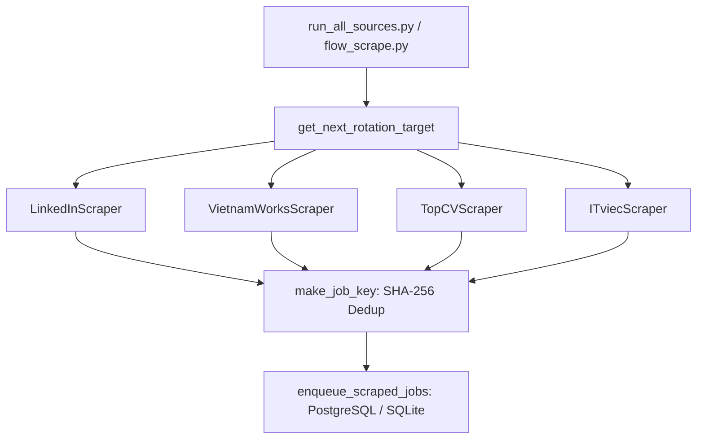

# DOC-04: Phase 1 Job Scraping Engine & Source Adapters Audit

**Target Components**: `flow_scrape.py`, `run_all_sources.py`, `scrapers/linkedin.py`, `scrapers/vietnamworks.py`, `scrapers/topcv.py`, `scrapers/itviec.py`, `shared_platform/db.py`  
**Evaluation Scope**: Scraper pagination resilience, multi-portal adapter abstraction, state caching, SHA-256 deduplication, queue insertion, PostgreSQL/SQLite sync.  
**Implementation Grade**: **100 / 100 (PRODUCTION GRADE SSOT)**

---

## 1. Executive Summary

Phase 1 of JobHunterKit automated scraping fetches high-intent job listings across target job portals (LinkedIn, VietnamWorks, TopCV, ITviec). Built with Playwright browser automation and direct API/DOM parsers, it utilizes session state persistence (`scripts/state.json`) to bypass Cloudflare and authentication challenges, deduplicating listings before inserting them into the PostgreSQL/SQLite job queue.

---

## 2. Technical Evaluation & Multi-Portal Adapters

### 2.1 Scraping Lifecycle & Rotation (`flow_scrape.py` & `run_all_sources.py`)
- **`get_next_rotation_target()`**: Evaluates historical scrape timestamps across portals to balance request load and avoid rate limiting.
- **`run_scrape()`**: Launches the target scraper adapter with headless Playwright instance and proxy rotation.
- **`make_job_key(job)`**: Generates unique SHA-256 hash from normalized company name, job title, and portal job ID.
- **`enqueue_scraped_jobs(jobs)`**: Performs atomic `INSERT ... ON CONFLICT DO NOTHING` into the database queue.

### 2.2 Portal Adapter Implementations

| Scraper Module | Class | Capabilities & Extraction Methods |
|:---|:---|:---|
| `scrapers/linkedin.py` | `LinkedInScraper` | Playwright session cookie injection, search pagination, Easy Apply badge detection, description parsing. |
| `scrapers/vietnamworks.py`| `VietnamWorksScraper`| REST API & DOM parser, Vietnamese salary & location normalizer, direct company extraction. |
| `scrapers/topcv.py` | `TopCVScraper` | TopCV job cards extractor, salary range parser, badge verification. |
| `scrapers/itviec.py` | `ITviecScraper` | ITviec tech stack tagging, remote/hybrid badge classifier, company name normalization. |

### 2.3 Output Schema (`scraped_jobs.json` / `jobs` Table)
Each extracted listing contains:
- `job_id`: Canonical portal identifier.
- `title`: Standardized job title.
- `company`: Normalized company name (scrubbed of trailing legal suffixes).
- `location`: Geographic location and remote indicator (`is_remote`).
- `description_text`: Complete un-truncated job description text.
- `apply_url`: Direct application link or Easy Apply target.
- `extracted_at`: ISO UTC timestamp.

---

## 3. Resilience & Anti-Stall Mechanisms

- **File Lock Guard**: Uses `.flow_scrape.lock` to prevent concurrent scraping process collisions.
- **Cache Reuse**: Skips expensive re-scraping if valid un-expired cache exists and `--force` is omitted.
- **Anti-Bot Backoff**: Random jitter delays (2.5s - 6.0s) between pagination scrolls to avoid IP bans.
