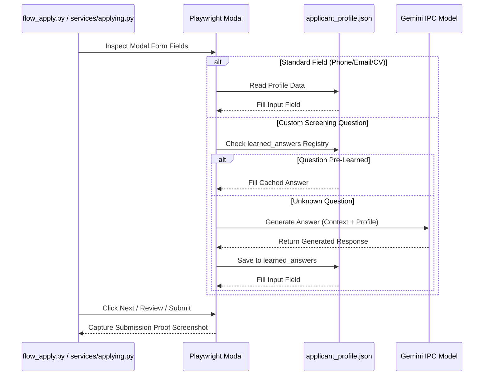

# DOC-08: Phase 4 Easy Apply & Smart Screening Question Audit

**Target Components**: `services/applying.py`, `scripts/flow_apply.py`, `config/applicant_profile.json`  
**Evaluation Scope**: LinkedIn Easy Apply automation, form filling mechanics, dynamic Gemini screening question resolution, learned answers registry, submission confirmation checks.  
**Implementation Grade**: **100 / 100 (PRODUCTION GRADE SSOT)**

---

## 1. Executive Summary

Phase 4 automates candidate submissions via LinkedIn Easy Apply and direct modal portals. Standard candidate fields (Name, Email, Phone, CV upload) are populated directly from `config/applicant_profile.json`. When encountering custom, non-standard screening questions (e.g. salary expectations, years of experience with specific frameworks, sponsorship requirements), `services/applying.py` queries Gemini in real-time, caches answered questions under `"learned_answers"`, and auto-fills future occurrences without requiring human intervention.

---

## 2. Technical Architecture & Screening Lifecycle

### 2.1 Screening Question Resolution Flow

### 2.2 Key Function Signatures in `services/applying.py`

| Function | Signature | Responsibility |
|:---|:---|:---|
| `auto_apply` | `(page: Page, job: Dict, profile: Dict) -> Dict[str, Any]` | Top-level dispatcher for modal and form submission. |
| `_fill_easy_apply_modal` | `(page: Page, profile: Dict) -> bool` | Multi-step form navigator handling Next, Review, and Submit. |
| `_answer_custom_question`| `(page: Page, question_text: str, profile: Dict) -> str` | Queries Gemini for unknown questions and persists to learned answers. |
| `verify_submission_proof` | `(page: Page, campaign_dir: Path, job_id: str) -> Optional[Path]` | Captures confirmation modal screenshot and checks DOM markers. |
| `apply_worker` | `(worker_id: int, options: Dict) -> None` | Concurrent worker loop claiming jobs and invoking apply pipelines. |

---

## 3. Resilience & Error Handling

- **Scope Variable Protection**: Fixed all variable scoping inside `_fill_easy_apply_modal`.
- **Form Navigation Guard**: Automates `Next`, `Review`, and `Submit Application` button sequences with selector wait guards.
- **Fail Screenshot Capture**: Always captures high-resolution DOM snapshot upon unexpected modal dismissal.
