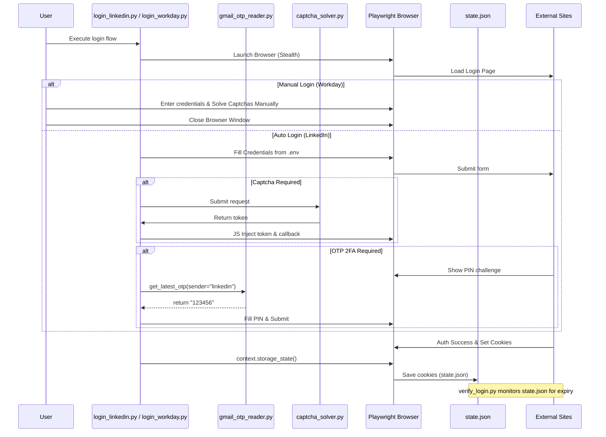

# Auth & Session Management (DOC-GAP-02, DOC-GAP-11)

This document covers the internal mechanisms for handling authentication, session cookies, manual and automated login flows, CAPTCHA solving, and OTP retrieval in JobHunterKit. 

## 1. CAPTCHA Solver Architecture
The system integrates with 3rd-party CAPTCHA solving services to automate challenges encountered during portal logins or scraping (e.g., Cloudflare blocks, GeeTest during login).

**Supported Providers:**
- `2captcha`
- `capsolver`

**Supported CAPTCHA Types:**
- **hCaptcha**
- **Cloudflare Turnstile**
- **GeeTest** (v3 with challenge strings, and v4 without challenges)

### Configuration and Provider Contract
Settings are managed via environment variables (or fallbacks to DB config):
- `CAPTCHA_API_KEY` or `CAPTCHA_SOLVER_API_KEY`: The API key for the service.
- `CAPTCHA_SOLVER_SERVICE`: Which provider to use (`2captcha` or `capsolver`). Defaults to `2captcha`.

The `CaptchaSolver` class (in [`core/captcha_solver.py`](file:///C:/Users/user/.gemini/antigravity/skills/JobHunterKit/core/captcha_solver.py)) polls the selected service with a timeout (default 180s) and interval (5s-10s). Once a token is returned, the toolkit uses specialized Javascript injection functions (e.g., `inject_geetest_token`) to populate hidden form fields and fire the required widget callbacks (`window.captchaObj.onSuccess`, `window.turnstile.reset()`) directly in the Playwright page context.

### Error Handling & Costs
- If an API key is missing, it raises a `ValueError`.
- Timeouts raise a `TimeoutError`.
- `check_balance()` is available to monitor the configured provider's account balance, though cost monitoring relies on the user regularly checking this metric.

## 2. Cookie & Session Management
All Playwright automation in the kit shares a central authentication state, allowing cross-script session persistence and preventing repeated logins.

### State Storage
Cookies and origins are stored locally in Playwright's `storageState` format within [`scripts/state.json`](file:///C:/Users/user/.gemini/antigravity/skills/JobHunterKit/scripts/state.json). 

### Session Lifecycle and Validation
Session validity is continuously verifiable via [`scripts/verify_login.py`](file:///C:/Users/user/.gemini/antigravity/skills/JobHunterKit/scripts/verify_login.py). The verifier parses `state.json` and checks for platform-specific authoritative token cookies:
- **LinkedIn**: `li_at`
- **TopCV**: `access_token`, `topcv_session`
- **Indeed**: `jsessionid`, `ctk`
- **VietnamWorks**, **ITViec**, **CareerJet**, **Glints**

If vital tokens expire or vanish, `verify_login.py` will flag the platform as unauthenticated. If run with the `--alert` flag, it can fire off a Telegram notification (`send_telegram`) advising the user to refresh the session.

### Cookie Manager Utilities
[`scripts/cookie_manager.py`](file:///C:/Users/user/.gemini/antigravity/skills/JobHunterKit/scripts/cookie_manager.py) provides helpers to:
- Convert standard browser JSON cookies into Playwright `storageState` structure.
- Merge raw cookie payloads into `state.json` non-destructively (updating matched domain/name pairs without erasing unrelated cookies).
- Manage `.env` credential variables programmatically.

## 3. Portal Login Flows

### Automated Login: LinkedIn
Defined in [`scripts/login_linkedin.py`](file:///C:/Users/user/.gemini/antigravity/skills/JobHunterKit/scripts/login_linkedin.py):
1. Launches Chromium with `playwright_stealth` applied to bypass basic SSO and bot-detection blocks.
2. Auto-fills credentials from `.env` (`LINKEDIN_EMAIL`, `LINKEDIN_PASSWORD`).
3. Monitors for security challenge PIN fields. If 2FA is triggered, it invokes the Gmail OTP Reader.
4. Continually polls the URL for successful login indicators (e.g., `/feed/`, `/mynetwork/`).
5. Dumps the final context cookies to `state.json` and asserts the existence of the `li_at` token.

### Manual Login: Workday (NAB & PropertyGuru)
Defined in [`scripts/login_workday.py`](file:///C:/Users/user/.gemini/antigravity/skills/JobHunterKit/scripts/login_workday.py):
1. Because many Workday portals have varied strict SSO or multifactor requirements, this flow is **manual**.
2. A headful browser is spawned, loading the login pages into separate tabs.
3. The script waits idly until the user manually authenticates and deliberately **closes the browser**.
4. Upon browser exit, the context state is harvested and appended to `state.json`.

## 4. Gmail OTP Automation
To handle 2FA pipelines seamlessly, [`scripts/gmail_otp_reader.py`](file:///C:/Users/user/.gemini/antigravity/skills/JobHunterKit/scripts/gmail_otp_reader.py) can autonomously intercept verification codes.

**OAuth2 Flow:** 
Depends on a Google API pickeld token (e.g., `token_applicant_at_gmail.com.pickle`) managed by the `GmailSync` skill. If expired, it uses `google-auth` to automatically hit the refresh endpoint.

**Extraction Logic:**
1. Polls the Gmail API for messages matching `from:<sender_hint> newer_than:<max_age_minutes>m`.
2. Resolves HTML/Plaintext Mime-types into a flat string.
3. Applies regular expressions looking for standard phrasing (`passcode`, `verification code`, `security code is`) followed by combinations of 4-10 alphanumeric characters or separated blocks.
4. Returns the stripped code back to the waiting login script (e.g., LinkedIn).

## 5. Security Considerations
- **Credential Storage**: Passwords and emails live in plain-text `.env` files.
- **Session State**: `state.json` holds highly sensitive plain-text session cookies (like `li_at`). If compromised, this grants total access to the candidate's active portal accounts.
- **Token Rotation**: The Google OAuth pickle token self-refreshes. However, platform sessions like LinkedIn must be re-obtained when `li_at` expires, guided by `verify_login.py` alerts.

## 6. Architecture Diagram

