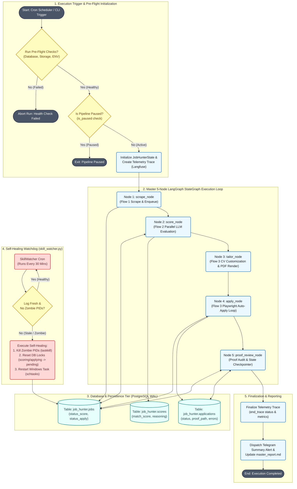
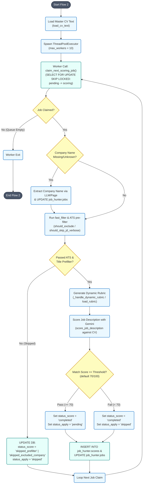
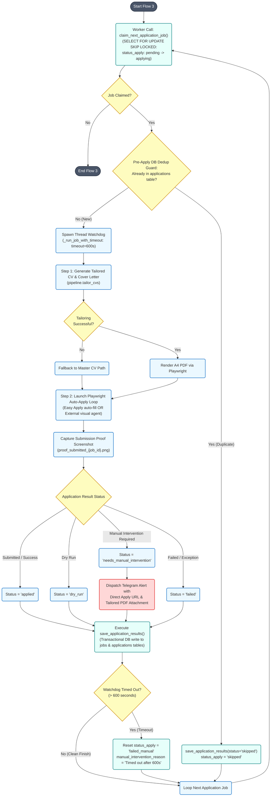
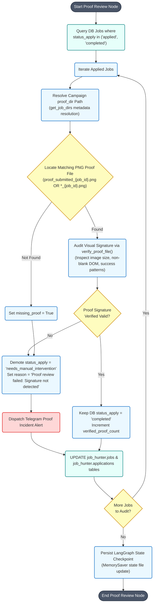
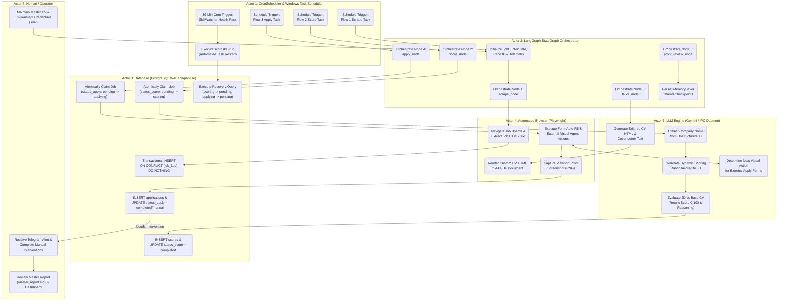

# JobHunterKit BPMN 2.0 Process Architecture & Workflow Specification

> [!NOTE]
> This document details the BPMN 2.0 process architecture, swim-lane actor responsibilities, sub-process workflows, and self-healing recovery mechanisms for the **JobHunterKit** pipeline. All diagrams are rendered using GitHub-flavored Mermaid syntax and derived directly from active production code.

---

## 1. Executive Summary & System Overview

The **JobHunterKit** pipeline is an enterprise-grade autonomous job acquisition engine built on top of [LangGraph](file:///C:/Users/user/.gemini/antigravity/skills/JobHunterKit/shared_platform/graph.py#L215-L240), [Playwright](file:///C:/Users/user/.gemini/antigravity/skills/JobHunterKit/scripts/flow_apply.py#L103-L111), [Google Gemini LLM](file:///C:/Users/user/.gemini/antigravity/skills/JobHunterKit/scripts/flow_score.py#L126-L150), and [PostgreSQL/Supabase](file:///C:/Users/user/.gemini/antigravity/skills/JobHunterKit/scripts/flow_scrape.py#L31-L99).

The system consists of **five core orchestrator nodes** executed within a stateful `StateGraph` wrapper:
1. [`scrape_node`](file:///C:/Users/user/.gemini/antigravity/skills/JobHunterKit/shared_platform/graph.py#L41-L90): Exhaustive multi-source web scraping and DB enqueuing ([`flow_scrape.py`](file:///C:/Users/user/.gemini/antigravity/skills/JobHunterKit/scripts/flow_scrape.py#L102-L216)).
2. [`score_node`](file:///C:/Users/user/.gemini/antigravity/skills/JobHunterKit/shared_platform/graph.py#L92-L117): Parallel LLM job description evaluation against base CV ([`flow_score.py`](file:///C:/Users/user/.gemini/antigravity/skills/JobHunterKit/scripts/flow_score.py#L232-L295)).
3. [`tailor_node`](file:///C:/Users/user/.gemini/antigravity/skills/JobHunterKit/shared_platform/graph.py#L119-L135): Dynamic CV customization and pixel-perfect PDF compilation.
4. [`apply_node`](file:///C:/Users/user/.gemini/antigravity/skills/JobHunterKit/shared_platform/graph.py#L137-L171): Playwright browser automation for Easy Apply and external forms ([`flow_apply.py`](file:///C:/Users/user/.gemini/antigravity/skills/JobHunterKit/scripts/flow_apply.py#L390-L506)).
5. [`proof_review_node`](file:///C:/Users/user/.gemini/antigravity/skills/JobHunterKit/shared_platform/graph.py#L173-L212): Computer vision proof auditing and checkpointer state persistence.

Complementing the core graph is a dedicated self-healing sidecar, [`SkillWatcher`](file:///C:/Users/user/.gemini/antigravity/skills/JobHunterKit/scripts/skill_watcher.py#L637-L800), running on a 30-minute cron cycle to inspect log heartbeats, break database lock deadlocks, terminate zombie processes, and trigger automated task restarts.

---

## 2. Master BPMN 2.0 Pipeline Diagram

The following master process diagram illustrates the end-to-end lifecycle of a job execution campaign, from trigger to completion, including pre-flight checks, state persistence, and anomaly sidecar monitoring.

---

## 3. Sub-Process Diagrams

### 3.1 Sub-Process 1: Flow 1 — Scraping & Enqueuing Queue (`flow_scrape.py`)

This sub-process handles exhaustive job discovery across multiple job boards, disk caching, ATS exclusion checks, and transactional database enqueuing.

```mermaid
flowchart TB
    classDef task fill:#EBF8FF,stroke:#3182CE,stroke-width:2px;
    classDef gate fill:#FEFCBF,stroke:#D69E2E,stroke-width:2px;
    classDef db fill:#E6FFFA,stroke:#319795,stroke-width:2px;
    classDef startEnd fill:#4A5568,stroke:#2D3748,stroke-width:2px,color:#FFF;

    Sub1Start(["Start Flow 1"]):::startEnd --> CheckRotate{"Check Target Mode<br/>(--rotate or empty args)"}:::gate
    
    CheckRotate -- "Rotate Active" --> SelectRotation("Select Next Rotation Target<br/>(Product Manager, AI PM, etc.)"):::task
    CheckRotate -- "Manual Args" --> UseCLIArgs("Use CLI Keyword & Location"):::task
    
    SelectRotation --> LoopSources("Iterate Scraping Sources<br/>(LinkedIn, ITViec, TopCV, Indeed, Glints, etc.)"):::task
    UseCLIArgs --> LoopSources

    LoopSources --> CheckPausedMid{"Is Pipeline<br/>Paused?"}:::gate
    CheckPausedMid -- "Yes" --> BreakLoop("Break Scraping Loop"):::task
    CheckPausedMid -- "No" --> ScrapeSource("Execute Scraper Module<br/>(live_linkedin_scrape / scraper.scrape_jobs)"):::task

    ScrapeSource --> SaveDisk("Progressive Save to Disk<br/>(scraped_jobs.json cache)"):::task
    SaveDisk --> DedupeLoop("Iterate Scraped Job Items"):::task

    DedupeLoop --> GenerateKey("Generate job_key<br/>(make_job_key: URL or source+company+title)"):::task
    GenerateKey --> ExcludedCompanyCheck{"Is Company Excluded?<br/>(ats_prefilter.is_company_excluded)"}:::gate

    ExcludedCompanyCheck -- "Yes (Excluded)" --> SetExclStatus("Set initial_score_status = 'skipped_excluded_company'<br/>Set initial_apply_status = 'skipped'"):::task
    ExcludedCompanyCheck -- "No (Clean)" --> SetPendingStatus("Set initial_score_status = 'pending'<br/>Set initial_apply_status = 'pending'"):::task

    SetExclStatus --> DBEnqueue("Execute DB SAVEPOINT & INSERT<br/>ON CONFLICT (job_key) DO NOTHING"):::db
    SetPendingStatus --> DBEnqueue

    DBEnqueue --> CheckSavepoint{"Savepoint<br/>Succeeded?"}:::gate
    CheckSavepoint -- "Yes" --> CommitItem("Increment new_jobs_count"):::task
    CheckSavepoint -- "No (Error/Conflict)" --> RollbackSavepoint("Rollback to SAVEPOINT"):::task

    CommitItem --> NextJob{"More Jobs in<br/>Current Source?"}:::gate
    RollbackSavepoint --> NextJob

    NextJob -- "Yes" --> DedupeLoop
    NextJob -- "No" --> NextSource{"More Sources<br/>to Scrape?"}:::gate

    NextSource -- "Yes" --> LoopSources
    NextSource -- "No" --> BreakLoop
    BreakLoop --> Sub1End(["End Flow 1"]):::startEnd
```

---

### 3.2 Sub-Process 2: Flow 2 — Parallel LLM Scoring Queue (`flow_score.py`)

This sub-process evaluates pending jobs against the Master CV using parallel worker threads, fast ATS pre-filtering, dynamic rubric generation, and atomic database row locking.

---

### 3.3 Sub-Process 3: Flow 3 — CV Tailoring & Auto-Apply Queue (`flow_apply.py`)

This sub-process coordinates dynamic CV tailoring, PDF rendering, browser auto-application via Playwright, worker watchdog timeout control, and Telegram manual intervention dispatch.

---

### 3.4 Sub-Process 4: Post-Application Proof Review & Verification Node (`verify_application_proofs.py`)

This sub-process audits saved application proof screenshots to verify legitimate submission confirmation signatures before finalizing candidate jobs as completed.

---

### 3.5 Sub-Process 5: SkillWatcher Self-Healing & Anomaly Recovery (`skill_watcher.py`)

This autonomous background sub-process monitors system heartbeats, cleans database deadlock states, kills zombie processes, and triggers task restarts.

```mermaid
flowchart TB
    classDef task fill:#EBF8FF,stroke:#3182CE,stroke-width:2px;
    classDef gate fill:#FEFCBF,stroke:#D69E2E,stroke-width:2px;
    classDef db fill:#E6FFFA,stroke:#319795,stroke-width:2px;
    classDef alert fill:#FED7D7,stroke:#E53E3E,stroke-width:2px;
    classDef startEnd fill:#4A5568,stroke:#2D3748,stroke-width:2px,color:#FFF;

    WatcherStart(["Cron Trigger: SkillWatcher"]):::startEnd --> CheckPostgres{"Check PostgreSQL Port 5432<br/>(_ensure_postgres_running)"}:::gate
    
    CheckPostgres -- "Unreachable" --> RestartPostgres("Start Windows Service '*postgres*'<br/>via PowerShell"):::task
    CheckPostgres -- "Responding" --> LoopFlows("Iterate Monitored Flows<br/>(flow1_scrape, flow2_score, flow3_apply, ipc_daemon)"):::task
    RestartPostgres --> LoopFlows

    LoopFlows --> ReadLog("Read Tail of Log File & Check mtime"):::task
    ReadLog --> CheckIntervention{"Waiting for Manual Telegram Intervention?<br/>(_is_waiting_for_intervention)"}:::gate

    CheckIntervention -- "Yes (Valid Wait)" --> BypassHealing("Bypass Self-Healing for Flow<br/>(Preserve Active Manual Wait State)"):::task
    CheckIntervention -- "No" --> CheckHeartbeat{"Log Updated Within Heartbeat Threshold?<br/>(45m scrape, 30m score, 30m apply, 15m ipc)"}:::gate

    CheckHeartbeat -- "Yes (Fresh Log)" --> CheckErrorLoop{"Detect Structured JSON / Error Loops?<br/>(_detect_fatal_error_loop)"}:::gate
    CheckHeartbeat -- "No (Stale Log)" --> MarkUnhealthy("Flag Flow as UNHEALTHY / STALE"):::task

    CheckErrorLoop -- "No Errors" --> FlowHealthy("Flag Flow as HEALTHY"):::task
    CheckErrorLoop -- "Yes (Looping)" --> MarkUnhealthy

    FlowHealthy --> NextFlowCheck{"More Flows<br/>to Inspect?"}:::gate
    BypassHealing --> NextFlowCheck

    MarkUnhealthy --> DetectZombie("Detect Zombie PID via PowerShell WMI<br/>(Get-WmiObject Win32_Process / Get-CimInstance)"):::task
    DetectZombie --> HasZombie{"Zombie PID<br/>Found?"}:::gate

    HasZombie -- "Yes" --> KillProcess("Execute taskkill /F /T /PID {pid}"):::task
    HasZombie -- "No" --> UnlockJobs("Execute unlock_stuck_jobs()<br/>UPDATE job_hunter.jobs:<br/>scoring -> pending | applying -> pending"):::db

    KillProcess --> UnlockJobs
    UnlockJobs --> UnlinkLocks("Unlink Leftover Disk Lockfiles<br/>(.flow_score.lock, .flow_apply.lock)"):::task
    UnlinkLocks --> RestartTask("Trigger Windows Task Scheduler Task<br/>(schtasks /run /tn {task_name})"):::task

    RestartTask --> RestartSuccess{"Task Restart<br/>Successful?"}:::gate
    RestartSuccess -- "Yes" --> AlertHealed("Send Telegram Alert: 🔄 Flow Self-Healed"):::alert
    RestartSuccess -- "No" --> AlertFail("Send Telegram Alert: ❌ Restart Failed"):::alert

    AlertHealed --> NextFlowCheck
    AlertFail --> NextFlowCheck

    NextFlowCheck -- "Yes" --> LoopFlows
    NextFlowCheck -- "No" --> WatcherEnd(["End SkillWatcher Pass"]):::startEnd
```

---

## 4. Swim-Lane Actor Responsibilities Diagram

The following swim-lane diagram organizes all process steps by their respective system actors, clarifying ownership across orchestration, database, browser automation, AI model execution, and human operator layers.

---

## 5. Process, Gateway & Event Catalog

### 5.1 Component Process Inventory

| Process ID | Name / Function | Source Code File & Line Reference | Inputs | Outputs | Primary Responsibility |
| :--- | :--- | :--- | :--- | :--- | :--- |
| **PRC-01** | `invoke_graph` | [`shared_platform/graph.py:L242-L311`](file:///C:/Users/user/.gemini/antigravity/skills/JobHunterKit/shared_platform/graph.py#L242-L311) | `args`, `dirs`, `state_file` | `JobHunterState` | Initializes state graph, creates trace, compiles workflow checkpointer. |
| **PRC-02** | `scrape_node` / `run_scrape` | [`shared_platform/graph.py:L41-L90`](file:///C:/Users/user/.gemini/antigravity/skills/JobHunterKit/shared_platform/graph.py#L41-L90) [`scripts/flow_scrape.py:L102-L216`](file:///C:/Users/user/.gemini/antigravity/skills/JobHunterKit/scripts/flow_scrape.py#L102-L216) | `keyword`, `location`, `source` | `scraped_jobs.json` | Scrapes job boards exhaustively and enqueues clean listings. |
| **PRC-03** | `enqueue_scraped_jobs` | [`scripts/flow_scrape.py:L31-L99`](file:///C:/Users/user/.gemini/antigravity/skills/JobHunterKit/scripts/flow_scrape.py#L31-L99) | `all_jobs`, `keyword`, `location` | DB Rows | Performs deduplication key check and transactional DB enqueuing. |
| **PRC-04** | `score_node` / `run_scoring` | [`shared_platform/graph.py:L92-L117`](file:///C:/Users/user/.gemini/antigravity/skills/JobHunterKit/shared_platform/graph.py#L92-L117) [`scripts/flow_score.py:L232-L295`](file:///C:/Users/user/.gemini/antigravity/skills/JobHunterKit/scripts/flow_score.py#L232-L295) | `jobs_file`, `cv_text`, `threshold` | `passed_jobs` | Evaluates pending jobs in parallel using Gemini LLM and dynamic rubrics. |
| **PRC-05** | `score_single_job` | [`scripts/flow_score.py:L33-L222`](file:///C:/Users/user/.gemini/antigravity/skills/JobHunterKit/scripts/flow_score.py#L33-L222) | `job`, `cv_text`, `dynamic_rubric` | Score JSON & DB | Performs ATS pre-filtering, dynamic rubric scoring, and score persistence. |
| **PRC-06** | `tailor_node` / `tailor_cvs` | [`shared_platform/graph.py:L119-L135`](file:///C:/Users/user/.gemini/antigravity/skills/JobHunterKit/shared_platform/graph.py#L119-L135) | `passed_jobs`, base CV | Tailored PDFs | Tailors CV HTML and compiles pixel-perfect A4 PDF documents. |
| **PRC-07** | `apply_node` / `run_apply` | [`shared_platform/graph.py:L137-L171`](file:///C:/Users/user/.gemini/antigravity/skills/JobHunterKit/shared_platform/graph.py#L137-L171) [`scripts/flow_apply.py:L390-L506`](file:///C:/Users/user/.gemini/antigravity/skills/JobHunterKit/scripts/flow_apply.py#L390-L506) | `passed_jobs`, tailored PDFs | Applied Count | Executes Playwright browser application loop and captures proof screenshots. |
| **PRC-08** | `save_application_results` | [`scripts/flow_apply.py:L251-L372`](file:///C:/Users/user/.gemini/antigravity/skills/JobHunterKit/scripts/flow_apply.py#L251-L372) | `job_id`, `app_status`, `error_msg` | DB Rows & TG Alert | Writes application record and notifies Telegram for manual interventions. |
| **PRC-09** | `proof_review_node` | [`shared_platform/graph.py:L173-L212`](file:///C:/Users/user/.gemini/antigravity/skills/JobHunterKit/shared_platform/graph.py#L173-L212) [`scripts/verify_application_proofs.py`](file:///C:/Users/user/.gemini/antigravity/skills/JobHunterKit/scripts/verify_application_proofs.py) | `proof_dir` screenshots | Audit DB State | Audits proof screenshots for visual submission signatures and demotes unverified jobs. |
| **PRC-10** | `check_flow` (SkillWatcher) | [`scripts/skill_watcher.py:L637-L800`](file:///C:/Users/user/.gemini/antigravity/skills/JobHunterKit/scripts/skill_watcher.py#L637-L800) | `FLOWS` definitions, log files | Health Status | Checks log staleness, detects zombie PIDs, and self-heals stuck jobs. |
| **PRC-11** | `unlock_stuck_jobs` | [`scripts/skill_watcher.py:L296-L361`](file:///C:/Users/user/.gemini/antigravity/skills/JobHunterKit/scripts/skill_watcher.py#L296-L361) | `flow_id`, `dry_run` | Unlocked Rows | Resets stuck DB states (`scoring` -> `pending`, `applying` -> `pending`) and unlinks lockfiles. |

---

### 5.2 Decision Gateways Catalog

| Gateway ID | Name / Expression | Type | Logic Condition | Outcomes |
| :--- | :--- | :--- | :--- | :--- |
| **GW-01** | `PreflightCheck` | Exclusive (XOR) | Database connection, storage directory write permissions, and `.env` presence. | **Pass**: Proceed to pipeline **Fail**: Abort run with exit code 1 |
| **GW-02** | `PauseCheck` | Exclusive (XOR) | `shared_platform.pipeline_state.is_paused()` returns `True`. | **True**: Exit workflow gracefully **False**: Continue execution |
| **GW-03** | `ExcludedCompanyCheck` | Exclusive (XOR) | `core.ats_prefilter.is_company_excluded(company)` | **Match**: `status_score = 'skipped_excluded_company'` **No Match**: `status_score = 'pending'` |
| **GW-04** | `FastFilter` / `PassPrefilter` | Exclusive (XOR) | Title exclusion rules (`fast_filter`) OR JD text length/expiration (`ats_prefilter`). | **Fail**: Skip LLM scoring, set `status_score = 'skipped_prefilter'` **Pass**: Proceed to LLM scoring |
| **GW-05** | `ScoreCheck` | Exclusive (XOR) | `match_score >= threshold` (Default: 70/100). | **Pass**: Set `status_score = 'completed'`, `status_apply = 'pending'` **Fail**: Set `status_score = 'completed'`, `status_apply = 'skipped'` |
| **GW-06** | `DedupGuard` | Exclusive (XOR) | Query `job_hunter.applications` for matching `job_key` or `clean_url` with status in `applied, completed, dry_run`. | **Duplicate**: Skip application **New**: Proceed with auto-apply |
| **GW-07** | `WatchdogCheck` | Exclusive (XOR) | Worker thread duration exceeds `JOB_TIMEOUT_SECONDS` (600 seconds). | **Exceeded**: Reset `status_apply = 'failed_manual'`, release slot **Clean**: Save normal status |
| **GW-08** | `SigValid` (Proof Verification) | Exclusive (XOR) | Visual proof signature detected in screenshot by `verify_proof_file()`. | **Valid**: Retain `status_apply = 'completed'` **Invalid/Missing**: Demote to `status_apply = 'needs_manual_intervention'` |
| **GW-09** | `CheckHeartbeat` / `DetectZombie` | Exclusive (XOR) | Log age exceeds threshold AND `PowerShell WMI` matches Python PID. | **Zombie Found**: Kill PID, reset DB locks, trigger Task Scheduler restart **Fresh/Waiting**: Bypassed |

---

### 5.3 Events Catalog

| Event ID | Event Name | BPMN Type | Trigger / Target | Description |
| :--- | :--- | :--- | :--- | :--- |
| **EVT-01** | `Start Pipeline` | Start Event | Cron / CLI command | Initiates main LangGraph execution cycle. |
| **EVT-02** | `Preflight Abort` | End Event (Error) | Unreachable DB / Missing ENV | Terminates process before work is claimed. |
| **EVT-03** | `Pause Signal` | Intermediate Catch Event | `is_paused()` file flag | Halts pipeline mid-run across all worker loops. |
| **EVT-04** | `Watchdog Timeout` | Timer Interrupt Event | 600-second thread timer | Interrupts hung Playwright application tasks. |
| **EVT-05** | `Telegram Intervention Alert` | Message Throw Event | Application blockage / missing proof | Dispatches Telegram alert with direct application URL and tailored PDF. |
| **EVT-06** | `SkillWatcher Heal Alert` | Message Throw Event | Zombie kill / Task restart | Dispatches Telegram notification upon self-healing. |
| **EVT-07** | `End Pipeline` | End Event | State Graph `END` node | Finalizes telemetry, updates summary reports, and exits cleanly. |

---

## 6. Error Handling & Self-Healing Matrix

| Failure Mode | Trigger Condition | Automated Detection Method | Self-Healing / Recovery Action | Final Status |
| :--- | :--- | :--- | :--- | :--- |
| **PostgreSQL Unreachable** | Port 5432 connection failure | `_ensure_postgres_running()` socket check | Auto-starts Windows `*postgres*` service via PowerShell. | System Recovered |
| **Scraper Network Disruption** | DB enqueue failure after scraping | `try...except` in `flow_scrape.py` | Preserves scraped jobs on disk (`jobs_file`); skips DB loss. | Scraped Cache Saved |
| **LLM Rate Limit / API Error** | 429/500 response from Gemini | `try...except` in `flow_score.py` | Rolls back DB transaction; marks `status_score = 'failed'`. | Logged & Retryable |
| **Playwright Thread Freeze** | Browser hangs during Easy Apply | 600s Thread Watchdog timer | Abandons hung daemon thread; sets `status_apply = 'failed_manual'`. | `failed_manual` |
| **Missing Submission Proof** | Screenshot absent or signature invalid | `proof_review_node` audit | Demotes status to `needs_manual_intervention`; alerts Telegram. | `needs_manual_intervention` |
| **Stale Worker / Zombie PID** | Log stale > 30m with active PID | `skill_watcher.py` WMI query | Kills PID (`taskkill /F /T`), executes `unlock_stuck_jobs`, restarts task. | Self-Healed & Restarted |

---
*Documentation generated dynamically from JobHunterKit codebase specifications.*
