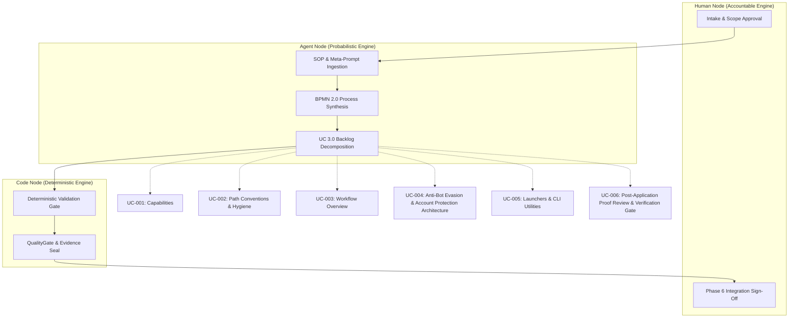
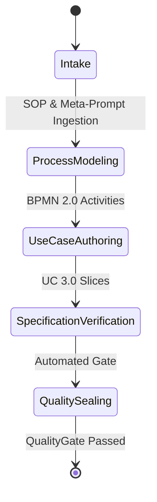

# BPMN 2.0 Process Workflows & FSM

> Auto-generated by UCBDDManager BPMNGenerator.
> Upstream Hierarchy: SOP & Meta-Prompts ──► BPMN 2.0 ──► UC 3.0
> Source hash: 94bed60c2a00c94589c0946aca62c7414be0ceccdf855ab2ee84690ecdfb476f

## 3-Pillar Swimlane Process Flow

## State Lifecycle & Invariants

