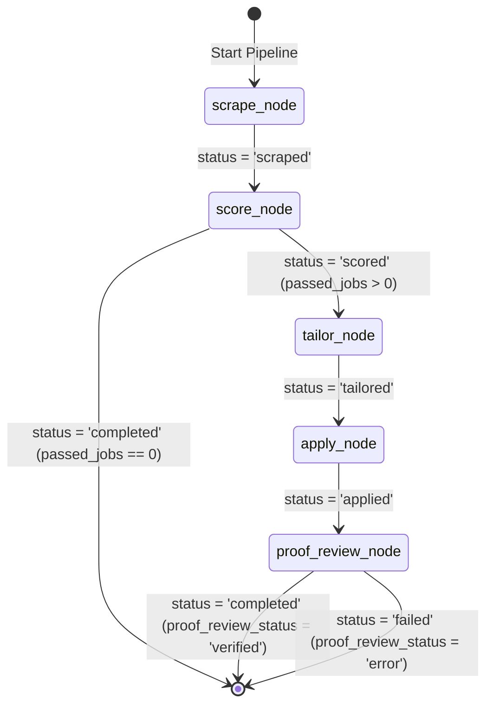

# LLM Routing & Pipeline State Architecture (SSOT)

| Field | Value |
|---|---|
| **System** | **JobHunterKit** (End-to-End Automated Job Search Pipeline) |
| **Updated** | 2026-08-14 |
| **Architecture Tier** | Level 3: LLM Integration, Model Encapsulation & Pipeline State |
| **Live Execution Mode** | Pure Local Antigravity CLI Routing (`agy -p`) via in-process `TaskManager.LLMProviderRouter` |

---

## 1. LLM Integration & Provider Routing Architecture

JobHunterKit utilizes a decoupled, resilient LLM routing architecture designed for local execution and zero external cloud API rate limits:

```mermaid
graph TD
    subgraph Caller Nodes [LangGraph Pipeline Nodes]
        ScoreNode[score_node / score_jd.py]
        TailorNode[tailor_node / tailor_jd.py]
        ApplyNode[apply_node / services/applying.py]
        ProofReviewNode[proof_review_node / llm_judge.py]
    end

    subgraph LangChain Model Encapsulation [shared_platform/]
        LCModel[GeminiIPCChatModel<br/>shared_platform/lc_model.py]
        Client[GeminiClient<br/>shared_platform/llm_client.py]
    end

    subgraph In-Process Execution [scripts/ipc_utils.py]
        CallAGY[call_antigravity()]
        HeuristicCheck{Fast Heuristic Rules?}
        Router[TaskManager.LLMProviderRouter]
    end

    subgraph Tier Hierarchy [Execution Tiers]
        Tier0[Tier 0: Local Heuristic Rules / Screening JSON]
        Tier1[Tier 1: AntigravityCLITier<br/>agy -p &lt;prompt&gt; --dangerously-skip-permissions]
        Tier2[Tier 2: LocalIPCTier<br/>Desktop Harness Fallback]
    end

    ScoreNode & TailorNode & ApplyNode & ProofReviewNode --> LCModel
    LCModel --> Client
    Client --> CallAGY
    CallAGY --> HeuristicCheck
    HeuristicCheck -- Match Found --> Tier0
    HeuristicCheck -- LLM Required --> Router
    Router --> Tier1
    Tier1 -.-> |Fallback if error| Tier2
```

### 1.1 In-Process Execution vs Direct Cloud APIs
- **No Direct Google Gemini API Calling**: Direct HTTP calls to Google Gemini cloud REST endpoints are completely retired and deprecated (`call_direct_gemini_api()` returns `""`).
- **Direct Router Execution**: All live consumers (`score_jd.py`, `tailor_jd.py`, `services/applying.py`, `llm_judge.py`) invoke `GeminiClient.call()` $\rightarrow$ `ipc_utils.call_antigravity()` $\rightarrow$ `TaskManager`'s `LLMProviderRouter` directly in-process.
- **Bypassing File-Based Queue**: The historic file exchange (`ipc/request_*.json` $\leftrightarrow$ `ipc/response_*.json`) is bypassed in live runs, eliminating disk I/O latency and file locking overhead.

### 1.2 LangChain `GeminiIPCChatModel` (`shared_platform/lc_model.py`)
`GeminiIPCChatModel` provides a standard LangChain `BaseChatModel` interface:
- **`_generate()`**: Iterates over incoming `BaseMessage` components (`SystemMessage`, `HumanMessage`, `AIMessage`), flattens them into a unified prompt string, and invokes `GeminiClient.call(prompt, json_mode=json_mode)`.
- **JSON Mode Handling**: Checks for explicit `json_mode` kwargs (`response_format="json"`) or detects `"json"` directives in prompt text, stripping markdown fences (` ```json ... ``` `) automatically.

---

## 2. Fallback Hierarchy & Protocols

| Tier | Provider / Engine | Invocation Mechanism | Timeout | Primary Scope |
|---|---|---|---|---|
| **Tier 0** | Local Rule Heuristic | `get_visual_agent_response()` | < 10ms | Screener answers (experience, salary, work authorization) & known DOM selectors |
| **Tier 1** | Antigravity CLI | `agy -p <prompt> --dangerously-skip-permissions` | 180s | Standard fit scoring, CV tailoring, and visual DOM navigation actions |
| **Tier 2** | Local IPC Harness | `ipc_client.call_antigravity()` | 120s | Desktop agent harness fallback |

### Auxiliary Background Daemon (`scripts/ipc_daemon.py`)
For headless background server deployments (`run_ipc_daemon.bat`), `ipc_daemon.py` operates as an auxiliary service:
- **Mutex Lock**: Binds TCP loopback port `127.0.0.1:56200` to guarantee single-instance execution.
- **Telegram Pipeline Pause**: Short-polls Telegram `/stop` and `/start` commands to pause/resume pipeline state in PostgreSQL (`job_hunter.pipeline_state`).
- **Worker Dispatch**: Listens on `ipc/request_*.json` via a 60-worker `ThreadPoolExecutor`.

---

## 3. Pipeline State Schema (`shared_platform/graph.py`)

The `JobHunterState` `TypedDict` defines the typed state passed across all LangGraph nodes:

| Field | Type | Description |
|---|---|---|
| `args` | `Any` | CLI execution arguments (stored as a `SerializableArgs` dict for checkpointer serialization). |
| `dirs` | `Dict[str, Any]` | Absolute paths to workspace directories (`scratch`, `output`, `campaigns`). |
| `state_file` | `str` | Path to local state file for resumability. |
| `script_dir_path` | `str` | Centralized skill root directory path. |
| `trace_id` | `str` | Unique LangFuse trace UUID. |
| `scraped_jobs_file` | `Optional[str]` | Path to cached JSON file containing scraped job listings. |
| `passed_jobs` | `List[Dict[str, Any]]` | List of job dictionaries that achieved fit score $\ge 70$. |
| `tailored_all` | `Dict[str, str]` | Mapping of `job_id` to generated tailored CV / Cover Letter PDF filepaths. |
| `applied_count` | `int` | Number of applications successfully submitted during this run. |
| `verified_proof_count` | `int` | Number of applications verified via post-submission proof screenshot review. |
| `unverified_proof_count` | `int` | Number of applications flagged for manual intervention. |
| `proof_review_status` | `str` | Status of proof verification stage (`'pending'`, `'verified'`, `'error'`). |
| `status` | `str` | Overall lifecycle status (`'scraped'`, `'scored'`, `'tailored'`, `'applied'`, `'completed'`, `'failed'`). |

---

## 4. State Transition Contract


