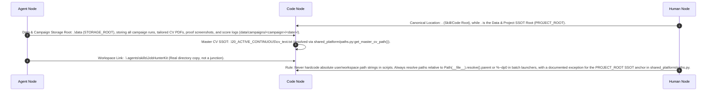
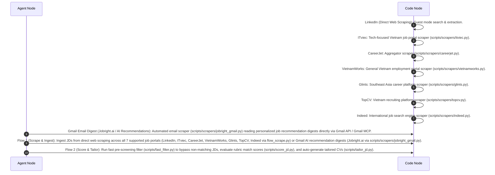
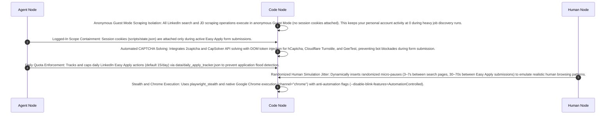
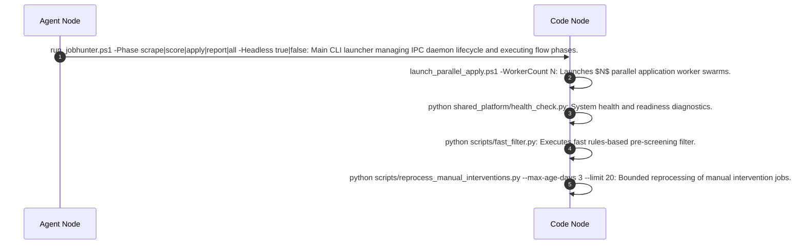

# Sequence Diagrams

> Auto-generated by UCBDDManager SequenceGenerator.
> Source hash: 9af239d17c64a2f12f426138be53eca52cc94dba6b39f5e34bd32fa1c4d312d7

### UC-001: Capabilities
```mermaid
sequenceDiagram
    autonumber
    participant AgentNode as Agent Node
    participant CodeNode as Code Node
    participant HumanNode as Human Node
    AgentNode->>CodeNode: Automatic scraping of recent job board JDs across 7 major portals (LinkedIn, ITviec, CareerJet, VietnamWorks, Glints, TopCV, Indeed) and Gmail digests.
    AgentNode->>CodeNode: Fit evaluation via LangChain GeminiIPCChatModel routed in-process to TaskManager.LLMProviderRouter with [AntigravityCLITier(), LocalIPCTier()] executing agy -p - --dangerously-skip-permissions over stdin.
    AgentNode->>CodeNode: Local PostgreSQL persistence layer (core/db_client.py, shared_platform/db.py) utilizing atomic SELECT ... FOR UPDATE SKIP LOCKED transactions and stale-claim recovery.
    CodeNode->>CodeNode: Semantic Pipeline Yield Sentry (scripts/skill_watcher.py, FL-701..FL-703) for statistical anomaly detection (zero-yield alarms, intervention spikes, false-skip spikes, checkpointer dropoff analysis, and closed-loop auto-recovery via scripts/recover_all_pipeline_jobs.py).
    CodeNode->>CodeNode: Authoritative BPMN 2.0 process flow and sub-process specification ([bpmn_workflows.md](bpmn_workflows.md)).
    CodeNode->>CodeNode: Complete 9-layer bidirectional Traceability Graph ([traceability_graph.md](traceability_graph.md)](traceability_graph.md)) and 100% verified Traceability Matrix ([traceability_matrix.md](traceability_matrix.md)).
    CodeNode->>CodeNode: System pre-flight health check diagnostics (shared_platform/health_check.py) for DB connectivity, environment variables, API keys, IPC daemon status, and session auth cookies (state.json li_at expiration).
    HumanNode->>CodeNode: Company name extraction & expired JD detection module (core/company_extractor.py) using multi-tier DOM selectors, title regex, JD text headers, and 15+ keyword pattern matchers (is_jd_text_expired).
    CodeNode->>CodeNode: D-drive SSOT storage migration (shared_platform/paths.py) anchoring data root at .\data (STORAGE_ROOT) and master CV at 20_ACTIVE_CONTINUOUS\cv_text.txt.
    AgentNode->>CodeNode: Stateful workflow orchestration via LangGraph StateGraph with checkpointer coverage (MemorySaver) -- used by the legacy pipeline.py CLI path; production Flow 2/Flow 3 (scripts/flow_score.py, scripts/flow_apply.py) run durable PostgreSQL DB-claim-based execution (FOR UPDATE SKIP LOCKED) and do not route through this graph.
```

### UC-002: Path Conventions & Hygiene


### UC-003: Workflow Overview


### UC-004: Anti-Bot Evasion & Account Protection Architecture


### UC-005: Launchers & CLI Utilities

