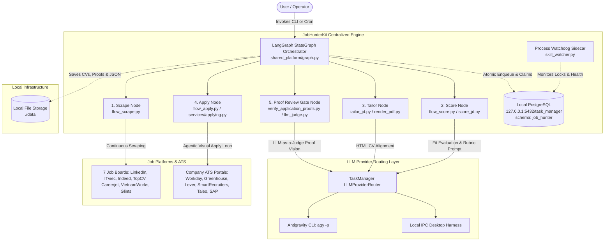

# JobHunterKit System Architecture (Level 1 SSOT)

| Field | Value |
|---|---|
| **System** | **JobHunterKit** (End-to-End Automated Job Search Pipeline) |
| **Updated** | 2026-08-14 |
| **Architecture Tier** | **Level 1: System Topology, Integration Boundaries & Infrastructure** |
| **Complete Tier Hierarchy** | **Level 0**: Business Process & Governance ([`bpmn_process.md`](bpmn_process.md)) **Level 1**: System Topology & Infrastructure ([`system_architect.md`](system_architect.md)) **Level 2**: Subsystems ([`database_architecture.md`](database_architecture.md), [`llm_routing_architecture.md`](llm_routing_architecture.md), [`apply_engine_architecture.md`](apply_engine_architecture.md), [`auth_session_management.md`](auth_session_management.md), [`cv_renderer.md`](cv_renderer.md), [`logging_observability.md`](logging_observability.md)) **Level 3**: Algorithms & Graph ([`dynamic_rubric_generation.md`](dynamic_rubric_generation.md), `shared_platform/graph.py`) **Level 4**: Function Catalog ([`function_list.md`](function_list.md) FL-001..FL-267) |
| **Authoritative SSOTs** | BPMN 2.0: [`bpmn_process.md`](bpmn_process.md) · Database: [`database_architecture.md`](database_architecture.md) & [`erd.md`](erd.md) · LLM: [`llm_routing_architecture.md`](llm_routing_architecture.md) · Traceability: [`traceability_graph.md`](traceability_graph.md) |

---

## 1. System Overview & Technology Stack

`JobHunterKit` is an autonomous job application automation platform designed to scrape multi-board postings, evaluate JD-candidate fit via dynamic LLM rubrics, generate tailored HTML/PDF CVs, navigate complex ATS portals using visual browser agents, and enforce post-application proof verification gates.

- **Language & Runtime**: Python 3.12+
- **Orchestration & Workflow**: LangGraph `StateGraph` with checkpointer persistence (`shared_platform/graph.py`).
- **Database & State Tracking**: **Local PostgreSQL** (`127.0.0.1:5432/task_manager`, dedicated `job_hunter` schema) connected via `psycopg2` in `core/db_client.py`. Concurrent worker queues are managed via atomic `SELECT ... FOR UPDATE SKIP LOCKED` transactions in `shared_platform/db.py`.
- **Browser Automation & Vision**: Headless/Headed Playwright (Chromium / native Chrome channel) with stealth `state.json` session persistence, dynamic visual screenshot DOM analyzers, and CAPTCHA / Gmail OTP resolution.
- **LLM Calling & Routing**: Encapsulated via `GeminiIPCChatModel` (`shared_platform/lc_model.py`) and `GeminiClient.call()` (`shared_platform/llm_client.py`), routing directly in-process via `ipc_utils.call_antigravity()` to `TaskManager`'s `LLMProviderRouter` with `[AntigravityCLITier(), LocalIPCTier()]` executing `agy -p <prompt> --dangerously-skip-permissions`. Direct Google Gemini cloud REST API calling is completely retired.
- **Telemetry & Observability**: LangFuse trace spans, token/latency scoring (`shared_platform/telemetry.py`), and continuous process watchdog monitoring (`scripts/skill_watcher.py`).

---

## 2. Deployment Topology & System Context

---

## 3. Subsystem Architecture Map

The system is decomposed into 7 specialized architectural specifications:

| Subsystem Area | Architectural Scope | Authoritative SSOT Document |
|---|---|---|
| **BPMN 2.0 Business Process** | End-to-end process workflows, sub-process models, actor swimlanes, gateway branches, and recovery routines. | [`bpmn_process.md`](bpmn_process.md) |
| **Database & Persistence** | Local PostgreSQL schema, connection pooling (`core/db_client.py`), transaction wrappers, and atomic claim queries. | [`database_architecture.md`](database_architecture.md) & [`erd.md`](erd.md) |
| **LLM Provider Routing** | `GeminiIPCChatModel` encapsulation, in-process routing, and prioritized CLI fallback tiers (`agy -p`). | [`llm_routing_architecture.md`](llm_routing_architecture.md) |
| **Visual Apply Engine** | Headless/Headed Playwright form automation, screenshot DOM analysis, smart screening heuristics, and 2-strike fail-fast visual loops. | [`apply_engine_architecture.md`](apply_engine_architecture.md) & [`ats_portal_matrix.md`](ats_portal_matrix.md) |
| **Auth & Anti-Bot Evasion** | Playwright `state.json` session cookie merging, CAPTCHA solver injection (Turnstile/hCaptcha), and Gmail OTP reading. | [`auth_session_management.md`](auth_session_management.md) |
| **CV Tailoring Subsystem** | Dynamic Jinja2 HTML templating, ATS keyword injection, and Playwright headless Chromium PDF rendering. | [`cv_renderer.md`](cv_renderer.md) & [`dynamic_rubric_generation.md`](dynamic_rubric_generation.md) |
| **Observability & Health** | LangFuse trace spans, stdout/stderr logging, 15-minute log freshness threshold, and zombie subprocess cleanup. | [`logging_observability.md`](logging_observability.md) |
| **Governance & Traceability** | 7-layer bidirectional traceability linking Use Cases (UC-001..006), FRs (001..025), FLs (001..267), and Checkpoints (CP-001..011). | [`traceability_matrix.md`](traceability_matrix.md) & [`traceability_graph.md`](traceability_graph.md) & [`checkpoints.md`](checkpoints.md) |
| **Operational Execution** | Production CLI launchers, environment secrets configuration, database initialization, and disaster recovery runbooks. | [`operations_runbook.md`](operations_runbook.md) & [`DEPLOYMENT_CHECKLIST.md`](DEPLOYMENT_CHECKLIST.md) |

---

## 4. State Tracking, Queue Management & Health Diagnostics

### 4.1 Job Ingestion, Scoring & Application Enums (`job_hunter.jobs`)

State tracking across jobs is strictly maintained in PostgreSQL schema `job_hunter`:

1. **Scraping Ingestion & Batch Status (`status_scrape` / `JobHunterState.status`)**:
   - `'scraped'`: Active batch scraping completed and saved to `scraped_jobs.json`.
   - `'cached'`: Scraper reused existing non-empty campaign cache without redundant network calls.
   - `'enqueued'`: Job successfully inserted into `job_hunter.jobs` (`ON CONFLICT (job_key) DO NOTHING`).
   - `'dedup_skipped'`: Job rejected at ingestion due to duplicate `job_key` or existing submission record in `job_hunter.applications`.
   - `'parse_error'`: Job card DOM structure unparseable during scraping.

2. **Scoring Status (`status_score`)**:
   - `'pending'`: Newly scraped job awaiting fit evaluation.
   - `'scoring'`: Actively claimed by a Flow 2 scoring worker with active `claimed_at` timestamp (`FOR UPDATE SKIP LOCKED`).
   - `'completed'`: Successfully evaluated via dynamic rubric; match score persisted in `job_hunter.scores`.
   - `'skipped_excluded_company'`: Company matched blacklist agency or excluded employer in `core/ats_prefilter.py`.
   - `'skipped_prefilter'`: Excluded by fast-filter heuristics (title mismatch, non-PM role, junior level, expired JD).
   - `'error'`: Transient or unrecoverable LLM parsing failure during scoring.

3. **Application Status (`status_apply`)**:
   - `'pending'`: High-fit job (score $\ge 70$) queued for automated submission.
   - `'skipped'`: Low-fit job (score $< 70$) or pre-filtered role bypassed for application.
   - `'applying'`: Actively claimed by a Flow 3 apply worker with active `claimed_at` timestamp (`FOR UPDATE SKIP LOCKED`).
   - `'completed'`: Application submitted successfully and validated by post-submission proof screenshot.
   - `'needs_manual_intervention'`: Blocked by interactive CAPTCHA, complex unlearned screening questions, or missing proof signature.
   - `'failed'`: Form submission failed after retries or Playwright worker timeout.
   - `'closed'`: Target job posting expired or taken down on employer portal.

---

### 4.2 Checkpointer Health & State Persistence Diagnostics

1. **LangGraph Checkpointer Health**:
   - `build_graph()` initializes state persistence using `MemorySaver()` (or `PostgresSaver`).
   - Health check verifies:
     - **Serialization Safety**: Ensures all 13 keys in `JobHunterState` adhere to msgpack/JSON serializability via `SerializableArgs`.
     - **Thread ID Scoping**: Every campaign run is bound to a unique `thread_id` (UUIDv4 / trace ID), enabling cross-node replay and failure resumption.
     - **Checkpointer Barrier Sync**: Nodes cannot transition unless previous step output dict validates against state schema.

2. **Database & Connection Pool Health (`core/db_client.py:check_db_health()`)**:
   - Verifies active connection to `127.0.0.1:5432/task_manager`.
   - Validates existence of schema `job_hunter` and core tables (`jobs`, `scores`, `applications`).
   - Checks available pool connections in `ThreadedConnectionPool(minconn=2, maxconn=10)`.

3. **Watchdog Health & Lock Self-Healing (`scripts/skill_watcher.py`)**:
   - Runs every 30 minutes to evaluate **15-Minute Log Freshness**.
   - If log age $> 15\text{m}$ while a worker PID is active:
     - Detects zombie process via PowerShell WMI (`Get-Process`).
     - Issues graceful termination (`taskkill /F /T`).
     - Invokes `unlock_stuck_jobs()` to reset stale DB claims (`scoring` $\rightarrow$ `pending` after 15m; `applying` $\rightarrow$ `pending` after 30m).
     - Triggers automated task restart and dispatches Telegram alert.

